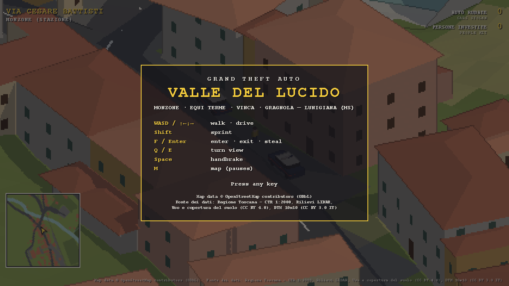
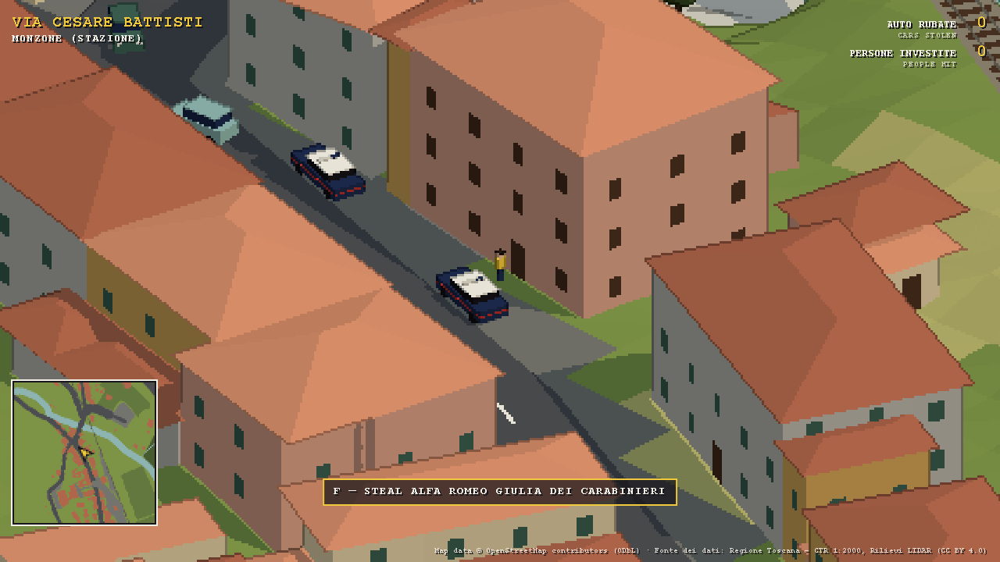
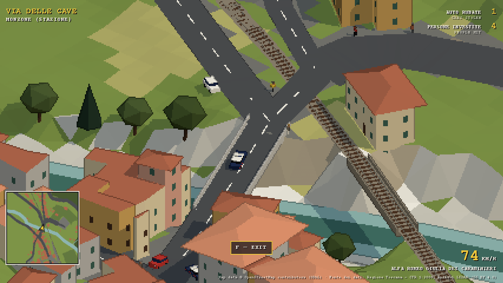
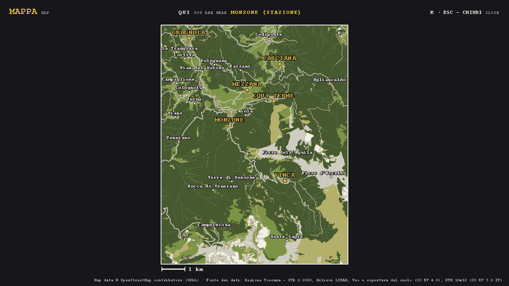
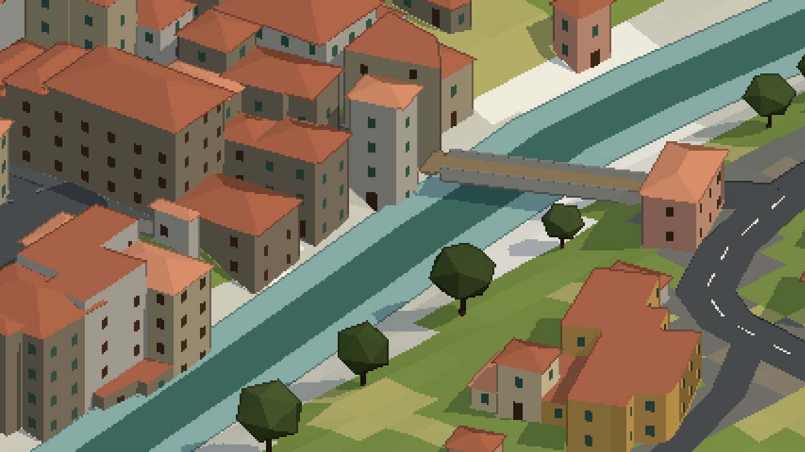
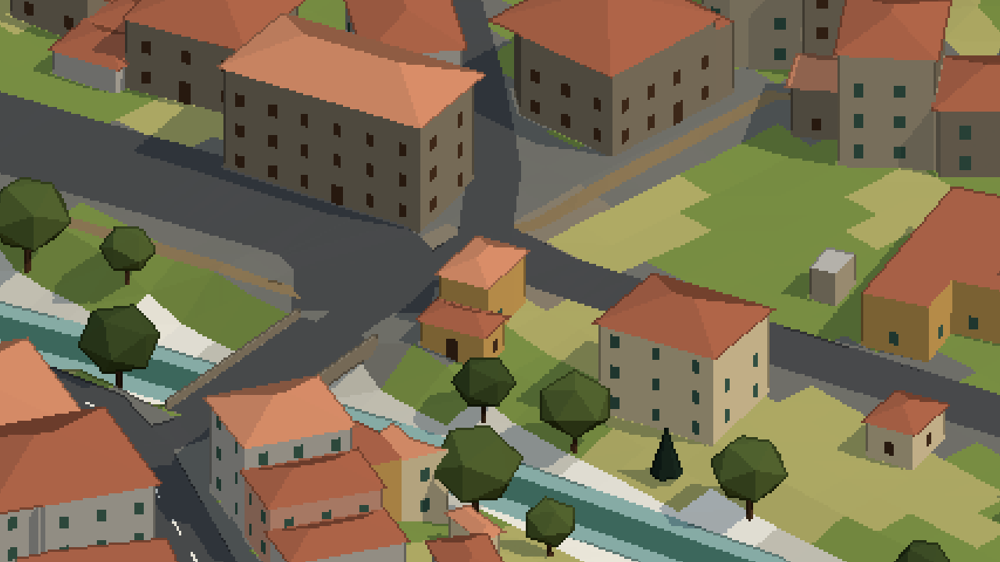
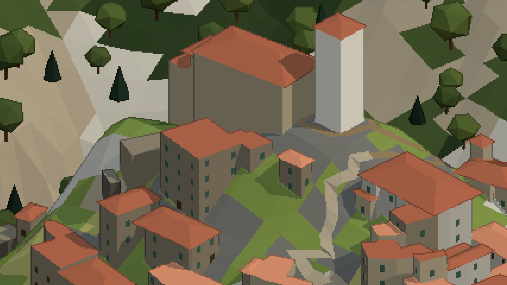
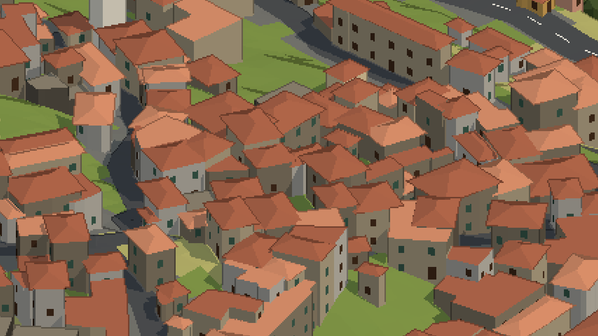
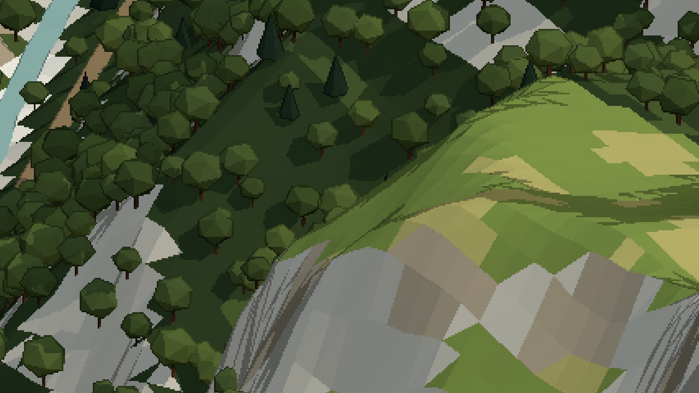

# Grand Theft Auto: Valle del Lucido



A small open-world car-theft game in isometric pixel art, set in the real Valle del Lucido in
Lunigiana, Tuscany. You walk the village streets, steal parked cars (the Carabinieri's Alfa Romeo
included, from right outside their station), carjack traffic and knock pedestrians over, all on a
map built from survey data of the actual valley. The view is an isometric camera that turns a
quarter at a time, with a low-resolution pixel-art look.

## The valley

The Valle del Lucido is a side valley of the Aulella in eastern Lunigiana, almost entirely in the
comune of Fivizzano (province of Massa-Carrara). It runs a little over 14 km, from the flat,
farmed valley floor at Gragnola, where the Lucido flows into the Aulella, up to pastures above
1,000 m in the northern Apuan Alps, under Pizzo d'Uccello and Monte Sagro. Much of it lies in the
Apuan Alps Regional Park. Local tradition says the torrent is called *Lucido*, "bright", for its
clear water.

The Lucido has two branches, the Lucido di Vinca and the Lucido d'Equi, which meet on the valley
floor at Monzone, under the 18th-century humpback bridge of Santa Lucia. Monzone has two halves:
Ponte di Monzone along the road and the railway, and Monzone Alto on a rocky spur under the
church of San Prospero. Up the Equi branch, Equi Terme has sulphurous springs used since Roman
times, karst caves open to visitors, a rock shelter (the Tecchia di Equi) with traces of
Neanderthals and cave bears, and the Solco di Equi, a narrow canyon towards Pizzo d'Uccello.
Downstream, Gragnola, the valley's historic market town, sits below the Malaspina Castello
dell'Aquila. In the 19th century, marble quarried on Monte Sagro brought the valley a short
period of prosperity; Monzone station's freight yard served the marble trade, with the stone
brought down by an aerial cableway. The Lucca–Aulla railway still climbs the valley through
Gragnola, Monzone and Equi Terme.

The playable map covers the whole valley, ridge to ridge: 7.8 × 10 km, from Gragnola up to
1,800 m.

- **Monzone**: the station quarter on Via Cesare Battisti, the Carabinieri station, and the
  stone lanes of Monzone Alto.
- **Vinca**: the stone village at the head of the western branch, at the end of the SP59's
  hairpins, under Pizzo d'Uccello and Monte Sagro.
- **Equi Terme**: the spa village up the eastern branch, with its own station, and above it the
  Solco di Equi gorge with the old marble road's tunnels and its quarries.
- **Gragnola**: the old town at the mouth of the valley, on the SR445 della Garfagnana and the
  Aulella, with the Castello dell'Aquila on the hill nearby.
- **The hill villages**: Tenerano, Viano, Pieve di Viano, Colognola, Campiglione and Vezzanello
  west of the Lucido; Ugliancaldo on the ridge above the Solco.
- **The Apuan ridge**: Pizzo d'Uccello's north face, the Garnerone, Foce di Vinca, Monte Sagro
  and Monte Borla, with the white marble quarries of the Sagro basin.
- Aiola, Mezzana, Codiponte, Casciana and the woods, streams and hairpins in between.

Roads, rivers, the railway, woods and place names come from OpenStreetMap. Buildings (with their
surveyed eave heights), road widths and surfaces come from Regione Toscana's 1:2000 technical map
(2019), the terrain from its 1 m LiDAR surveys (2010 and 2012), and the bare rock, pastures and
quarries from its land-cover map (2019).

This is a fan project. It is not affiliated with or endorsed by Rockstar Games or Take-Two
Interactive; "Grand Theft Auto" is their trademark.

## Screenshots

| | |
|---|---|
|  |  |
| On foot in Monzone, next to the Carabinieri's car | Over the Lucido in the stolen Giulia |
|  |  |
| The full map (M) | Gragnola, on the Lucido |
|  |  |
| Equi Terme | Monzone Alto and San Prospero |
|  |  |
| Vinca | The Solco di Equi and its quarries |

## Requirements

- Node 24. It runs the TypeScript tests and map tools directly, with no build step.
- pnpm 10 (`packageManager` is pinned in `package.json`; `corepack enable` provides it).
- A browser with WebGL, and Web Audio for the sound.

## Run

```sh
pnpm install
pnpm dev
```

Open http://localhost:5173. Every load is a new world. Add `?seed=N` (for example
`http://localhost:5173/?seed=42`) to replay the same world: the seed drives every random choice,
so the same seed and the same keys give the same game.

In dev mode, the backslash key toggles the Ritmo monitor, and http://localhost:5173/lab.html is
the audio audition page: every sound on a button, its params on sliders, heard from a distance you
pick (see [docs/audio.md](docs/audio.md#the-audition-page)).

## Controls

| Key | On foot | Driving |
|---|---|---|
| W A S D or arrow keys | walk along the screen directions | up: throttle, down: brake and reverse, left/right: steer |
| Shift | sprint | |
| F or Enter | enter the nearest vehicle (steal, enter or carjack) | get out |
| Q / E | turn the view a quarter left / right | same |
| Space | | handbrake |
| H | | horn while held; in the Carabinieri car, siren on or off |
| M | full map (pauses the game); M or Esc closes it | same |

The bindings live in `bindings` in `src/sim/schema.ts`. The HUD shows the street and district you
are in, cars stolen, people hit, the action the key would take, a speedometer while driving, and
a minimap. M opens the full map: the whole area north-up with the villages, hamlets and main
peaks named and your position marked.

## Sound

Every sound is synthesised in the browser with Web Audio, with no sample files: engines with a
virtual gearbox, tyres on each surface, horns and the Carabinieri siren, crashes, footsteps,
voices, wind, crickets, birds, farm dogs, the village church bells striking the hours, and the
Lucido and its streams. Each sound reaches you through outdoor acoustics: it fades with distance
and under the background noise, so you hear only what is near; houses and hills muffle it, the air
dulls it, it shifts in pitch as it passes, far crashes arrive late, and loud ones echo off the
slopes. The first key or click (the one that dismisses the title card) starts the sound. See
[docs/audio.md](docs/audio.md).

## Scripts

| Script | What it does |
|---|---|
| `pnpm dev` | Vite dev server on port 5173 |
| `pnpm build` | production build into `dist/` |
| `pnpm preview` | serves `dist/` on port 4173 |
| `pnpm check` | `typecheck`, then `lint`, then `test` |
| `pnpm typecheck` | `tsc` (no emit) |
| `pnpm lint` | `oxlint` with the Ritmo plugin, then `ritmo-devtools lint src/sim/index.ts` |
| `pnpm test` | `node --test` over `src/**/*.test.ts` |
| `pnpm map` | rebuilds `src/sim/map/monzone.json` from `data/raw` |
| `pnpm fetch-osm` | downloads the OpenStreetMap extract again into `data/raw/lunigiana.osm.gz` |
| `pnpm fetch-rt` | downloads the Regione Toscana sources again into `data/raw/rt` |

## Layout

| Path | Contents |
|---|---|
| `src/sim/` | the simulation: Ritmo schema, systems, collision, routes, tuning. Headless and deterministic |
| `src/sim/systems/` | one file per system group (spawn, enter/exit, foot, drive, traffic, pedestrians, physics, contacts, populate) |
| `src/sim/map/` | the generated map (`monzone.json`), its types and lookups (heights, walls, road graph) |
| `src/render/` | Three.js host code: pixel pipeline, static world meshes, actor meshes, the render schedule |
| `src/audio/` | Web Audio host code: the audio schedule, the acoustics director, the speaker and mixer, the synths, the audition page |
| `src/hud/` | DOM HUD: location names, score, prompt, speedometer, minimap, full map (M) |
| `src/tools/` | the map pipeline (`build-map.ts`), the downloaders (`fetch-osm.ts`, `fetch-rt.ts`) and a top-down preview renderer |
| `src/main.ts` | browser host: builds the scene, makes the runtime, runs the fixed loop |
| `index.html` | canvas, HUD markup and title card |
| `lab.html` | the audio audition page (dev server only) |
| `data/raw/` | pinned map inputs: OSM extract, Regione Toscana CTR and LiDAR |
| `docs/` | architecture, map pipeline, gameplay and audio notes |

## Rebuilding the map

```sh
pnpm map
```

The build reads only `data/raw` and takes about 7.5 s. Its output is deterministic: with the
same inputs, `monzone.json` (about 36 MB) comes out byte-identical. Never edit `monzone.json`
by hand.

Inputs in `data/raw`:

- `lunigiana.osm.gz`: an OpenStreetMap API 0.6 extract of the play area plus 100 m (lat
  44.1060–44.1977, lon 10.0925–10.1925), written by `pnpm fetch-osm` (`src/tools/fetch-osm.ts`)
  from 4 × 4 `https://api.openstreetmap.org/api/0.6/map?bbox=...` tiles. Every land-use, natural,
  building, leisure or amenity multipolygon is fetched whole with
  `https://api.openstreetmap.org/api/0.6/relation/<id>/full`, because most of a forest's member
  ways lie outside the play area. Elements are merged by id and sorted, so the same OSM data
  always gives the same file.
- `rt/`: Regione Toscana data from the Geoscopio cartoteca, written by `pnpm fetch-rt`
  (`src/tools/fetch-rt.ts`, which needs `unzip`; the download URLs are pinned there):
  - `ctr/<sheet>_<layer>.shp.gz` + `.dbf.gz`: CTR 1:2000 (2019), the 25 sheets that map ground
    in the play area (23D11–15, 23D18–21, 23D26–31, 23D34–37, 23D43, 23D46, 23D47, 23D53–55),
    layers `AED` (buildings with eave elevations), `AGE` (garages, ruins), `AVI` (road surfaces
    with street names) and `AZR` (the area each sheet maps).
  - `dtm.bin` + `dtm.json`: the 1 m LiDAR terrain model, 46 tiles of the 2010 flight and 19 of
    the 2012 flight (Monte Sagro and the Carrara side), mosaicked, cropped to the play area plus
    32 m and averaged to 2 m cells. The 0.65 km² no flight covers come from the 10 m DTM.
  - `ucs.json.gz`: the land cover 1:10 000 (2019) polygons the build uses (quarries, bare rock,
    sparse vegetation, pastures, heath), from the Regione Toscana WFS.

Downloading the OSM data again pulls current edits, so the map changes. The files in `data/raw`
are what pins it. `node src/tools/preview-map.ts` draws a top-down PNG of the built map (see
[docs/map.md](docs/map.md)).

## Data attribution and licences

- Map data © OpenStreetMap contributors, available under the Open Database License (ODbL) 1.0:
  https://www.openstreetmap.org/copyright. `monzone.json` is a derived database and stays under
  the ODbL.
- Buildings, road surfaces, elevation and land cover: "Fonte dei dati: Regione Toscana – Rilievi
  LIDAR", the Carta Tecnica Regionale 1:2000 and the Uso e copertura del suolo 2019, under
  Creative Commons Attribution 4.0 (https://creativecommons.org/licenses/by/4.0/), and the DTM
  10x10 metri, under Creative Commons Attribution 3.0 Italia
  (https://creativecommons.org/licenses/by/3.0/it/), from the Geoscopio cartoteca:
  https://www502.regione.toscana.it/geoscopio/cartoteca.html.

The game shows these credits on the title card and in the HUD.

Sources for "The valley": [Grotte di Equi, *La Valle del Lucido*](https://grottediequi.it/territorio/la-valle-del-lucido/),
[*Il nome Valle del Lucido*](https://aipiedidelleapuane.wordpress.com/2017/02/28/il-nome-valle-del-lucido/),
the Italian Wikipedia pages for [Monzone](https://it.wikipedia.org/wiki/Monzone),
[Equi Terme](https://it.wikipedia.org/wiki/Equi_Terme), [Gragnola](https://it.wikipedia.org/wiki/Gragnola_(Fivizzano)),
[the Aulella](https://it.wikipedia.org/wiki/Aulella) and
[Monzone station](https://it.wikipedia.org/wiki/Stazione_di_Monzone-Monte_dei_Bianchi-Isolano),
[Visit Tuscany: Equi Terme](https://www.visittuscany.com/en/towns-and-villages/equi-terme/), and the
valley study in [*ARQ*](https://arqarqt.revistas.csic.es/index.php/arqarqt/article/download/39/36/37).

## Documentation

- [docs/architecture.md](docs/architecture.md): simulation and host, schedules, state, input,
  rendering, audio, HUD and checks.
- [docs/audio.md](docs/audio.md): how the game sounds and why: data flow, the acoustics, every
  sound, the calibration, the audition page and tests.
- [docs/map.md](docs/map.md): the map pipeline, the JSON format and the data's limits.
- [docs/gameplay.md](docs/gameplay.md): on foot, vehicles, traffic, pedestrians, score and tuning.
